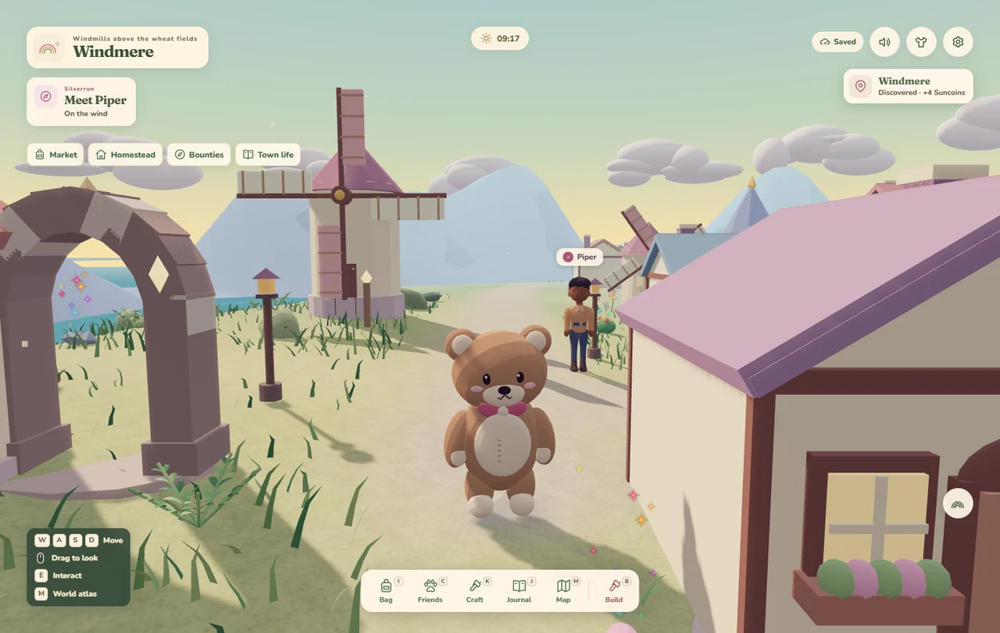
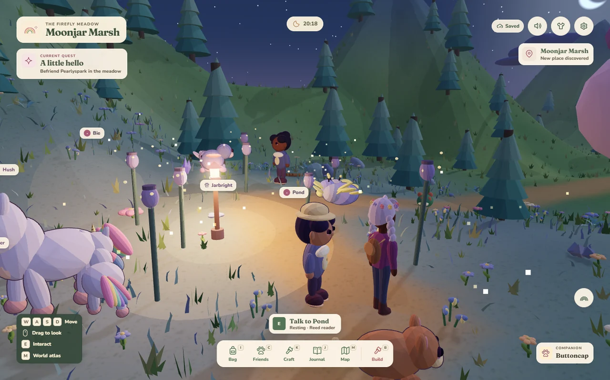

# 🌈 Rainbow Roam

A cozy browser adventure where you can befriend a unicorn, grow a cottage garden, and follow the road wherever it goes.


## A few places to wander

| 🌾 Windmere | ✨ Moonjar Marsh |
| --- | --- |
|  |  |
| Follow the west road from Spirehaven to the windmills. | Take a lantern-lit walk after dusk. |

### ⚓ All aboard the Black Marigold

Follow the coast road to Corsair Cove. At the end of the jetty, take the gangplank aboard and explore the cargo hold below deck.


## Play locally

Install Node.js 22.12 or newer, then run these commands and open the local address Vite prints.

```sh
npm ci
npm run dev
```

Move with **WASD** or the arrow keys, drag to look, and press **E** to interact. Use **M** for the map and **V** for the Voyage Atlas. Touch controls appear on mobile.

Run `npm run build` to create the web build in `dist/` and the offline **Rainbow Roam.html**. Serve the web build over HTTPS or localhost. Progress saves in your browser. A second window waits for the active window to close before loading your save.

Third-party library and font notices are in [public/licenses](public/licenses).
