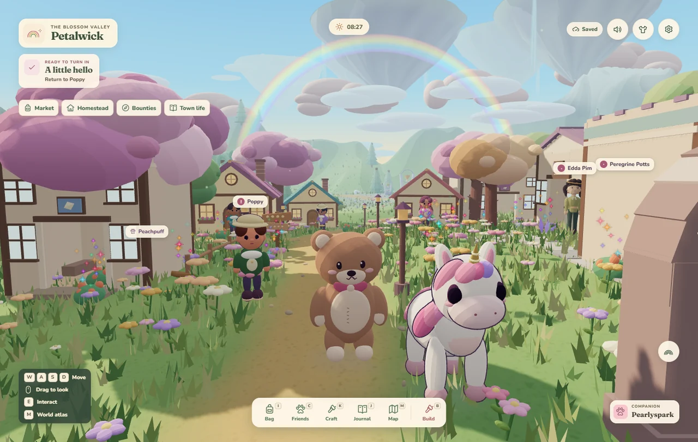
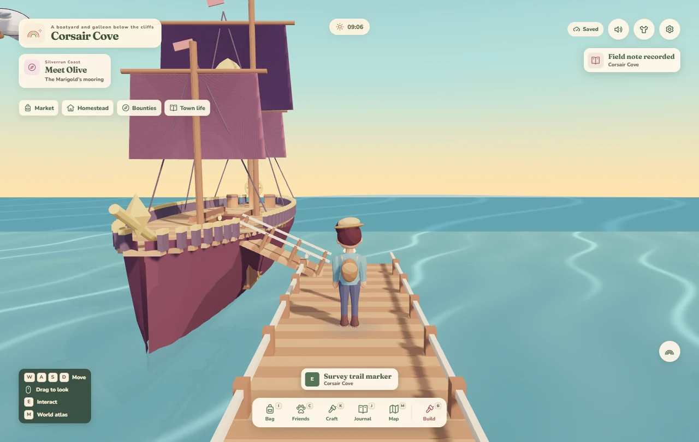

# 🌈 Rainbow Roam

A cozy browser adventure where you can befriend a unicorn, grow a cottage garden, and follow the road wherever it goes.

**[🌈 Play Now](https://kztp47.github.io/rainbow-roam/)**



## A few places to wander

| 🌾 Windmere | ✨ Moonjar Marsh |
| --- | --- |
|  |  |
| Follow the west road from Spirehaven to the windmills. | Take a lantern-lit walk after dusk. |

### ⚓ All aboard the Black Marigold

Follow the coast road to Corsair Cove. At the end of the jetty, take the gangplank aboard and explore the cargo hold below deck.



## Play locally

Install Node.js 22.12 or newer, then run these commands and open the local address Vite prints.

```sh
npm ci
npm run dev
```

Move with **WASD** or the arrow keys, drag to look, and press **E** to interact. Use **M** for the map and **V** for the Voyage Atlas. Touch controls appear on mobile.

Open **Friends → Evolution chart** to look up every three-stage companion line. Pet, feed, or play with a befriended companion to earn friendship, then choose **Evolve** when you have the listed offering.

Click or tap a nearby wild creature in the overworld, then choose a companion to battle with. Win and select **Catch** to add it to your Friends. Press **E** to offer a treat when the creature’s offering prompt is visible, or **Shift + E** to challenge it.

Open **Friends → Pet battles** for friendly turn-based matches or **Friends → Breed pets** to pair two companions for two Meadow biscuits. Inside a cave, look for the rune seal near the entrance. Solve its clue to open the reward room, then take the stairs and swirling portal to explore the lower floors.

Run `npm run build` to create the web build in `dist/` and the offline **Rainbow Roam.html**. Serve the web build over HTTPS or localhost. Progress saves in your browser. A second window waits for the active window to close before loading your save.

After building, run `node scripts/verify-wild-battles.mjs rules` and `node scripts/verify-wild-battles.mjs browser` to check wild battle rules and the desktop and touch capture flows.

Third-party library and font notices are in [public/licenses](public/licenses).
